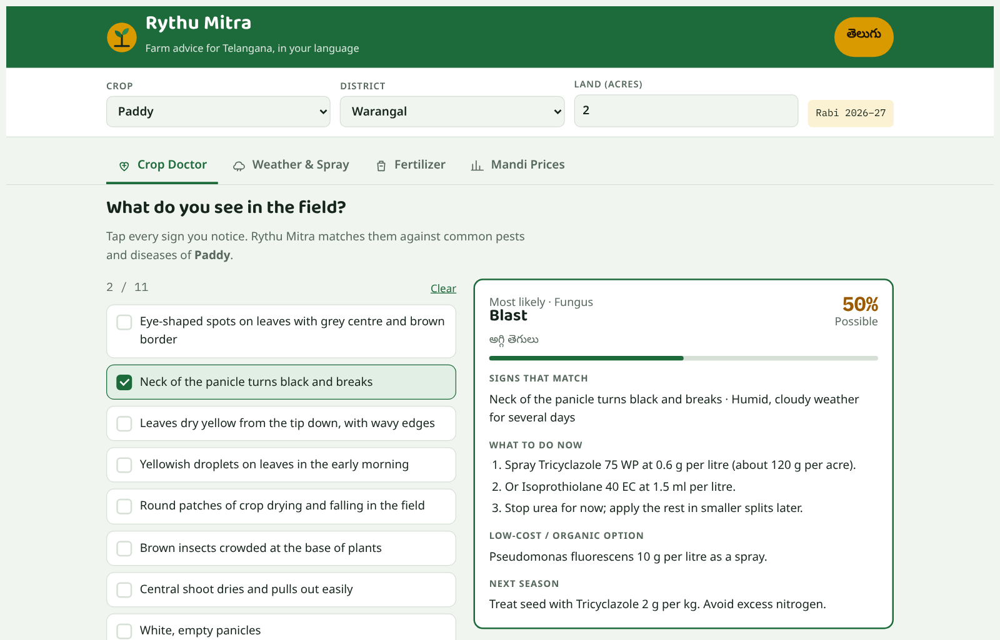
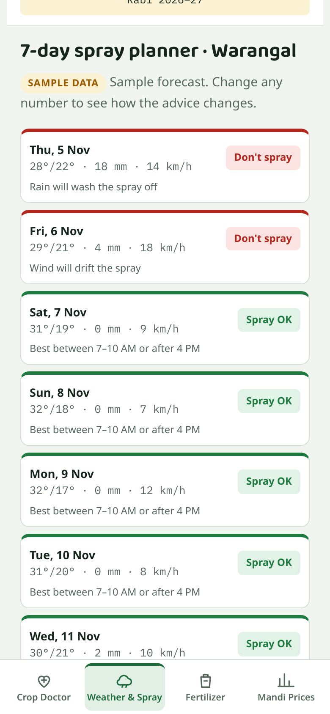
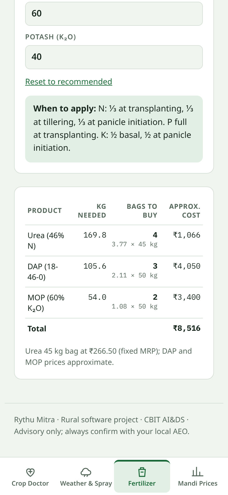
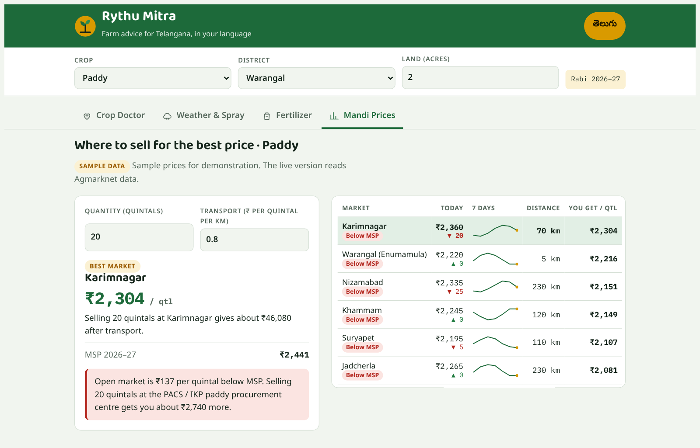
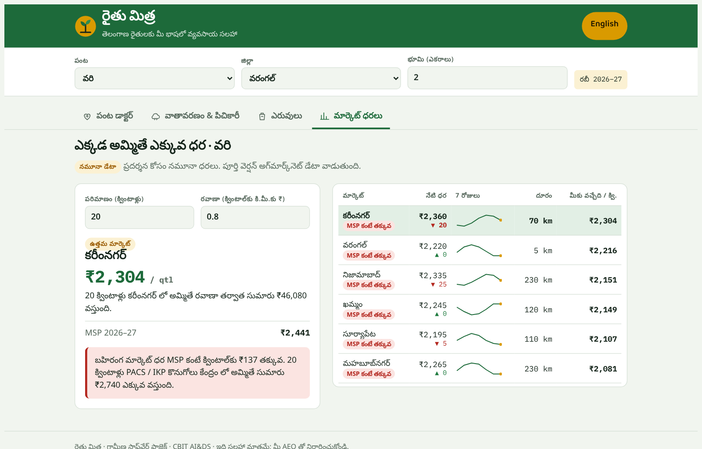

# Rythu Mitra (రైతు మిత్ర)

A bilingual (Telugu and English) farm advisory web app for small and marginal farmers in Telangana. It diagnoses common pests and diseases from visible symptoms, plans the week's spraying around the weather, works out how many bags of fertilizer to buy, and shows which market pays the most after transport and whether the price is below the Minimum Support Price (MSP).

Built as a rural problem-statement project, CBIT AI&DS.

Live demo: https://hamza1jaweed.github.io/rythu-mitra/



| Spray planner on a phone | Fertilizer calculator on a phone |
| --- | --- |
|  |  |

| Mandi prices (English) | Mandi prices (Telugu) |
| --- | --- |
|  |  |

## Problem

Most Telangana farmers hold less than 1 hectare and rely on input dealers and neighbours for advice. They lose crop to pests identified too late, waste money spraying before rain, buy the wrong amount of fertilizer, and often sell below the MSP because they don't compare markets.

## Features

| Module | What it does | Method |
|---|---|---|
| Crop Doctor | The farmer taps visible symptoms; the app ranks likely pests and diseases with a % match, treatment, an organic option and prevention for next season | Weighted rule-based expert system (coverage × focus score) |
| Weather & Spray | 7-day planner marks each day Spray OK, Careful or Don't spray, with weekly field tips | Rule engine on rain, rain probability, wind, humidity and temperature |
| Fertilizer | Converts an N-P-K need (state recommendation or Soil Health Card values) into kg and bags of urea, DAP and MOP, with cost and a split schedule | Nutrient balance: DAP for P, urea for the remaining N, MOP for K |
| Mandi Prices | Ranks nearby markets by net price after transport; warns when the open-market price is below MSP 2026-27 and points to the right procurement centre | Net = modal price − distance × transport rate |

Covers 5 crops (paddy, cotton, maize, chilli, red gram), 20 pests and diseases and 6 districts. Every screen works in Telugu and English, switched with one button, and the layout is designed for phones first, with a bottom tab bar.

## How the engines work

All four engines are pure functions in `src/engine.js`. They don't touch the page, so the same code runs in the browser and under Node for testing.

### Crop Doctor scoring

Each disease has a weight for each of its symptoms. For a disease with symptom weights w and the set S of symptoms the farmer selected:

```
coverage = Σ w(s) for s in S that belong to the disease  /  Σ w(s) over all of the disease's symptoms
focus    = (number of selected symptoms the disease explains) / |S|
score    = round(100 × coverage × (0.75 + 0.25 × focus))
```

Coverage measures how much of the disease's pattern is present. Focus penalises a disease that explains only some of what the farmer sees. Scores of 70 or more are a strong match, 40-69 medium, and results below 15 are hidden.

### Spray rules

| Condition | Verdict |
| --- | --- |
| Rain ≥ 5 mm or rain probability ≥ 60% | Don't spray (rain washes the chemical off) |
| Wind > 15 km/h | Don't spray (drift) |
| Next day rain ≥ 10 mm or probability ≥ 70% | Careful |
| Maximum temperature ≥ 35 °C | Careful: spray only early morning or evening |
| Otherwise | Spray OK |

### Fertilizer arithmetic

Worked example for paddy at the state recommendation of 120:60:40 kg/ha on 1 acre (1 ha = 2.471 acres):

```
need per acre:  N 48.6 kg, P₂O₅ 24.3 kg, K₂O 16.2 kg
DAP  = 24.3 / 0.46                 = 52.8 kg   (also supplies 52.8 × 0.18 = 9.5 kg N)
Urea = (48.6 − 9.5) / 0.46         = 84.9 kg
MOP  = 16.2 / 0.60                 = 27.0 kg
```

Bags are rounded up (45 kg urea, 50 kg DAP and MOP). Urea uses its fixed MRP of ₹266.50 per bag; DAP and MOP prices are approximate.

### Market ranking

For each market trading the crop, net price per quintal = modal price − distance (km) × transport rate (₹ per quintal per km). Markets are sorted by net price. If even the best net price is below MSP, the app shows how much more the farmer would get by selling to the government procurement centre (for example, PACS / IKP centres for paddy or CCI for cotton).

## Run it

The live demo is at the link at the top of this page.

To run it locally, open `dist/rythu-mitra.html` in any browser. It is a single self-contained file: no server, no install and no internet needed. The interface fonts load from Google Fonts when online. Offline, Telugu text falls back to the phone's own Telugu font (Android and iOS ship one) or Nirmala UI / Gautami on Windows.

## Tests

26 tests cover all four engines and the knowledge base. They need Node 18 or newer and no packages.

```bash
node --test tests/rythu-mitra.test.js
```

What the tests check:
- Disease ranking: correct top match, scores 15-100 and sorted, and extra unrelated symptoms lowering the score.
- Fertilizer: the hand calculation above, the products supplying exactly the nutrients needed, bags always covering the requirement, and no negative urea.
- Spray rules: every threshold, including the boundaries.
- Markets: net-price formula, sort order, and MSP advice only when the price is below MSP.
- Knowledge base:
  - every disease uses only its own crop's symptoms
  - every district has a symmetric distance to every market
  - the MSP values match the 2026-27 government decision
  - English and Telugu have exactly the same 93 interface strings.

## Project structure

```
src/
  index.html     page shell
  styles.css     phone-first design, light and dark themes
  data.js        knowledge base: symptoms, diseases, NPK, MSP, markets, distances
  i18n.js        all interface text in English and Telugu
  engine.js      decision engines (pure functions, run in browser and Node)
  app.js         user interface and state
tests/
  rythu-mitra.test.js   engine and data tests (node --test)
build.py         bundles src/ into dist/rythu-mitra.html
dist/
  rythu-mitra.html      ready-to-open single file
docs/screenshots/       images used in this README
index.html       opens dist/rythu-mitra.html (used by GitHub Pages)
```

## Rebuild

After editing anything in `src/`, rebuild the single-file version and rerun the tests:

```bash
python build.py          # on some systems: python3 build.py
node --test tests/rythu-mitra.test.js
```

## Data sources

- MSP for Kharif Marketing Season 2026-27: Cabinet Committee on Economic Affairs (CCEA), Government of India, 13 May 2026. Paddy (common) ₹2,441, maize ₹2,410, tur (red gram) ₹8,450 and cotton (medium staple) ₹8,267 per quintal. Chilli has no MSP.
- Pest and disease management: standard ICAR and PJTSAU (Professor Jayashankar Telangana Agricultural University) recommendations.
- Fertilizer: urea at its fixed MRP of ₹266.50 per 45 kg bag; DAP and MOP prices approximate.
- Mandi prices and weather are sample data, clearly labelled in the app. A production version would read the Agmarknet API (data.gov.in) for prices and IMD or Open-Meteo for forecasts.

## Limitations

- Prices and weather are generated sample data, so the Mandi and Weather tabs demonstrate the logic, not real conditions.
- Diagnosis is rule-based and only knows the 20 listed pests and diseases. It cannot identify anything outside that list, and a photo-based model would be needed to diagnose from images.
- Doses are general recommendations; local soil, variety and stage of crop can change them.
- Road distances between market towns are approximate.

## Disclaimer

Advisory only. Farmers should read product labels and confirm with their Agriculture Extension Officer or the Kisan Call Centre (1800-180-1551).

## Licence

MIT. See [LICENSE](LICENSE).
